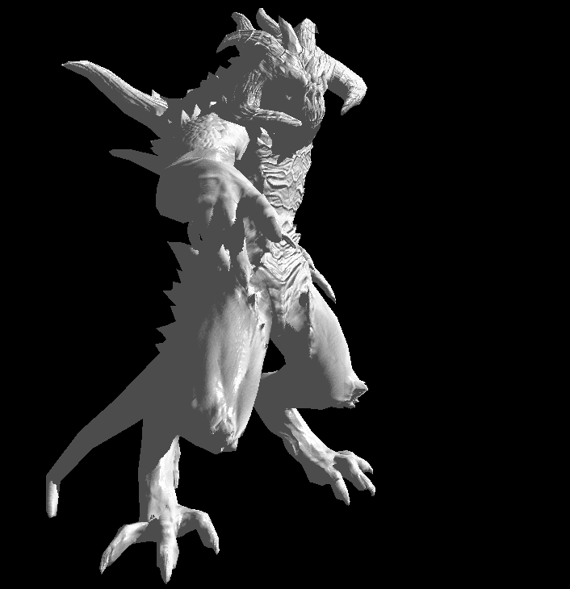
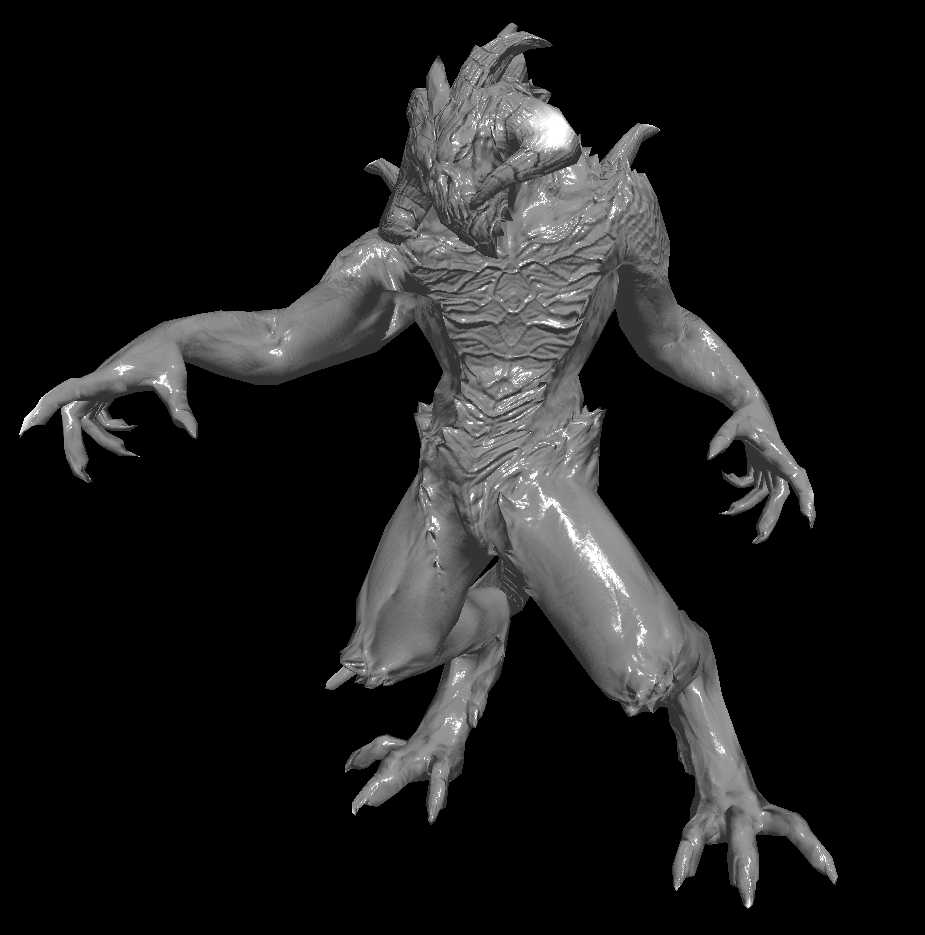
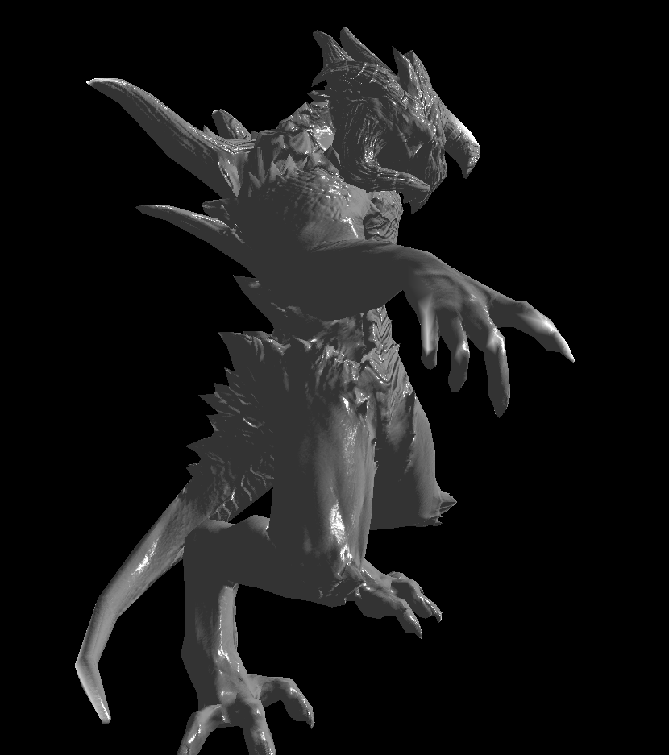
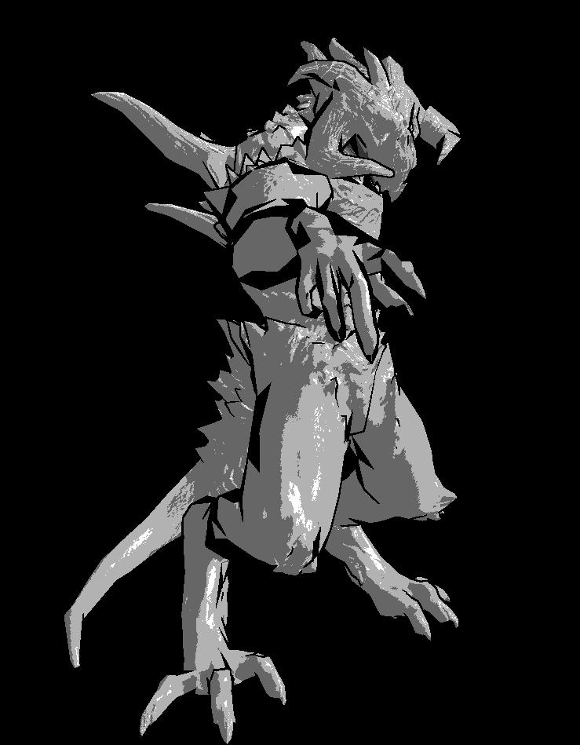
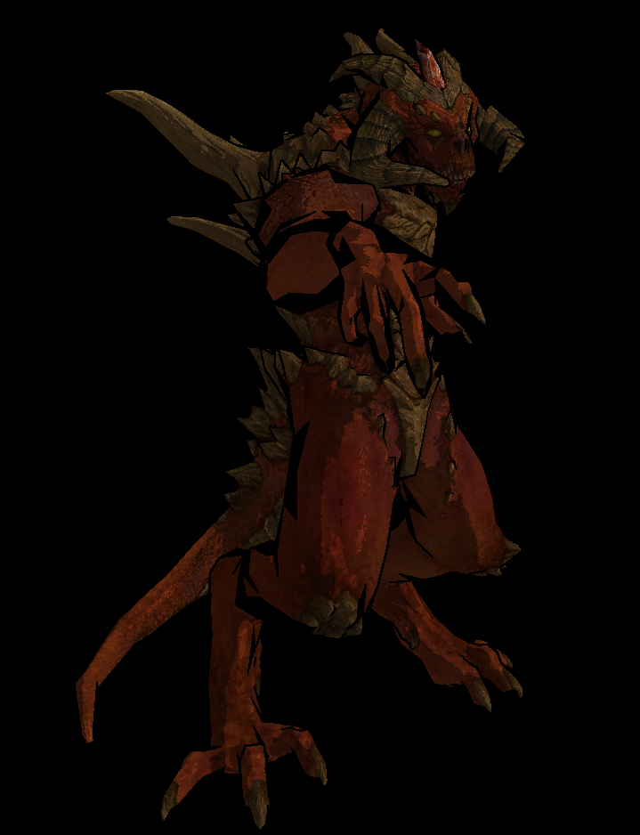

# Diablo Renderer

A renderer implemented in C++ by following the
[Tiny Renderer tutorial series](https://github.com/ssloy/tinyrenderer), extended with an interactive SDL2 viewer.

## Progress

<table>
  <tr>
    <th>Phong Shading</th>
    <th>Triangle Mesh</th>
  </tr>
  <tr>
    <td>
      
    </td>
    <td>
      
    </td>
  </tr>

  <tr>
    <th>Normals Rendering</th>
    <th>Texture Rendering</th>
  </tr>
  <tr>
    <td>
      
    </td>
    <td>
      
    </td>
  </tr>

  <tr>
    <th colspan="2">Ambient Occlusion</th>
  </tr>
  <tr>
    <td>
      
    </td>
    <td>
      
    </td>
  </tr>
  <tr>
    <th colspan="2">Tune Shading</th>
  </tr>
  <tr>
    <td>
      
    </td>
    <td>
      
    </td>
  </tr>
</table>

