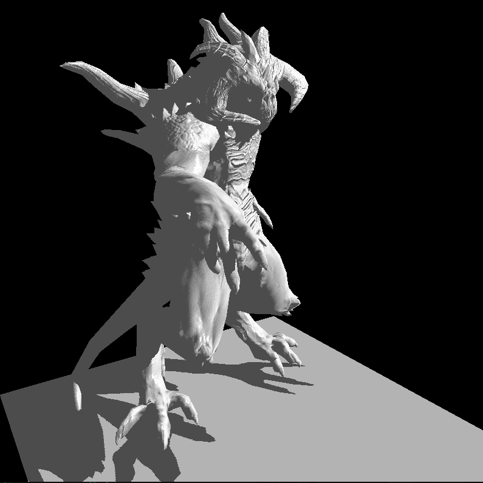

# Diablo Renderer

A software renderer implemented in C++ by following the
[Tiny Renderer tutorial series](https://github.com/ssloy/tinyrenderer), extended with an interactive SDL2 viewer.

## Progress

## Progress

<table>
  <tr>
    <th>Phong Shading</th>
    <th>Wireframe Overlay</th>
  </tr>
  <tr>
    <td>
      
    </td>
    <td>
      
    </td>
  </tr>
  <tr>
    <th>Vertex Normals</th>
    <th>Shadow Mapping</th>
  </tr>
  <tr>
    <td>
      
    </td>
    <td>
      
    </td>
  </tr>
  <tr>
    <th colspan="2">Textured Rendering</th>
  </tr>
  <tr>
    <td colspan="2" align="center">
      
    </td>
  </tr>
</table>

