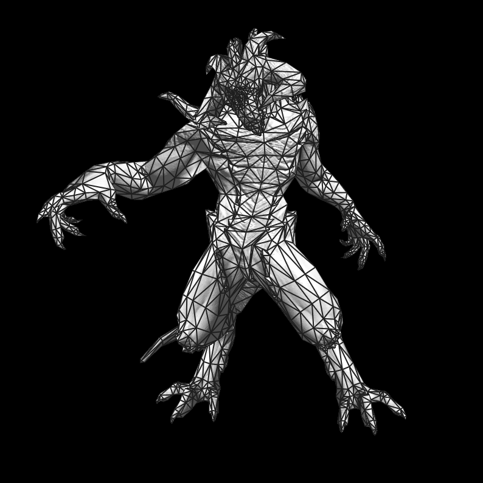
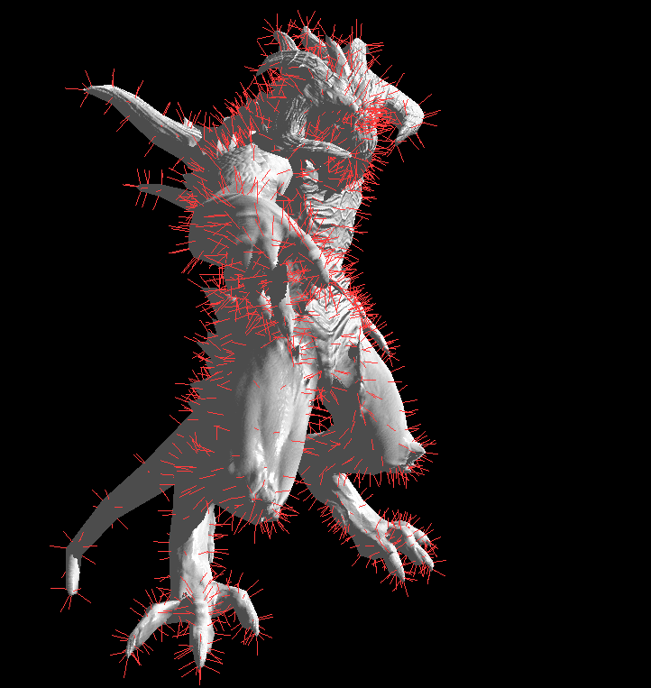
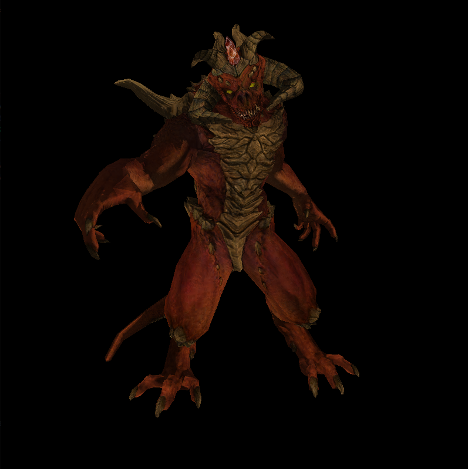

My implementation of the [Tiny Renderer tutorial series](https://github.com/ssloy/tinyrenderer)
Includes:

1. an interactive SDL2 viewer with camera controls
2. wireframe rendering
4. normal visualization

## Wireframes

## Normals

## Textures

