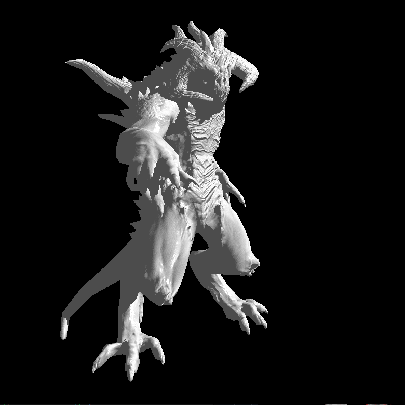
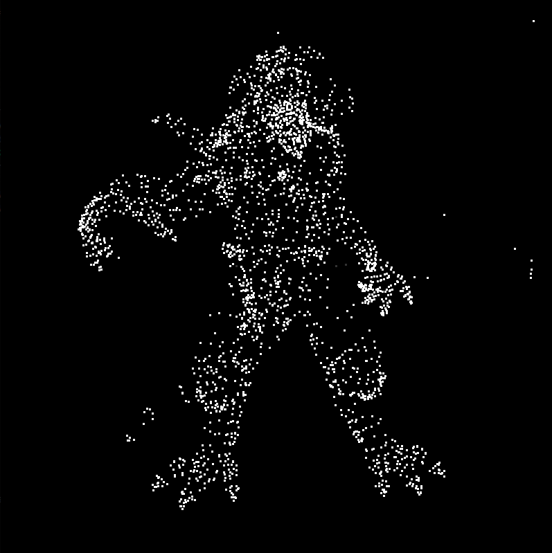

# Diablo Renderer

A software renderer implemented in C++ by following the
[Tiny Renderer tutorial series](https://github.com/ssloy/tinyrenderer), extended with an interactive SDL2 viewer.

## Progress

<table>
  <tr>
    <th>Textured Rendering</th>
    <th>Wireframe Overlay</th>
  </tr>
  <tr>
    <td>
      
    </td>
    <td>
      
    </td>
  </tr>
  <tr>
    <th>Vertex Normal Visualization</th>
    <th>Point Cloud View</th>
  </tr>
  <tr>
    <td>
      
    </td>
    <td>
      
    </td>
  </tr>
     <td>
      
    </td>
</table>

